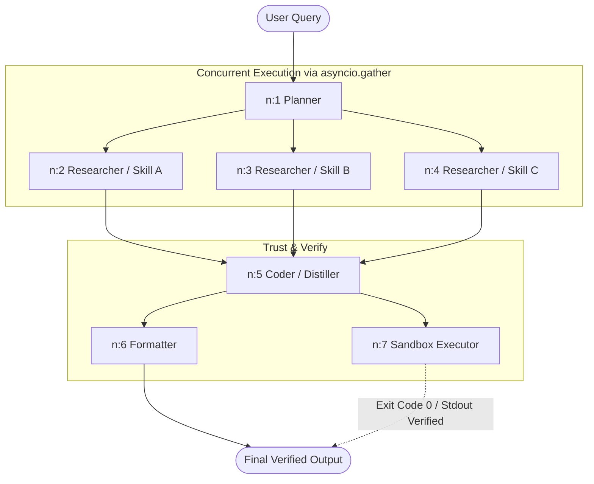

# Multi-Agent DAG Orchestrator (Session 8)

[](#)
[](#)
[](#)
[](#)
[](#)

A production-grade, framework-free multi-agent orchestrator transitioning from the Session 7 sequential MPDA loop (`Perception -> Decision -> Action`) to a **dynamic Directed Acyclic Graph (DAG)** of specialized skills. Evaluated on the **Product Research, Spec Comparison & Review Sentiment Domain**.

---

## Table of Contents
- [Architecture Overview](#architecture-overview)
- [Evidence Session Mapping](#evidence-session-mapping)
- [Part 1: The Five Base Queries](#part-1--the-five-base-queries)
- [Part 2: Parallel Fan-Out (Concurrency Proof)](#part-2--parallel-fan-out-concurrency-proof)
- [Part 3: Critic Pass/Fail with Dynamic Recovery](#part-3--critic-passfail-with-dynamic-recovery)
- [Part 4: Coder Skill & Subprocess Sandbox Execution](#part-4--coder-skill--subprocess-sandbox-execution)
- [Part 5: New Skill — `review_sentiment`](#part-5--new-skill--review_sentiment)
- [Change Inventory & Architectural Invariants](#change-inventory--architectural-invariants)
- [Honest Engineering Notes](#honest-engineering-notes)

---

## Architecture Overview



### Key Architectural Invariants
1. **The Model Writes the Graph:** The Planner emits declarative JSON describing nodes, dependencies, and metadata. The Executor (`flow.py`) deterministically runs every node whose predecessors are complete or skipped.
2. **True Concurrency Barrier:** Sibling nodes without inter-dependencies execute concurrently under `asyncio.gather`. Layer wall-clock equals $\max(\text{branches})$, not the sum.
3. **Atomic Persistence & Resume:** Graph state (`graph.json`) and node execution states (`nodes/n_*.json`) are written atomically (`write-tmp -> os.replace`), allowing mid-flight SIGKILL recovery without losing completed nodes.
4. **Skills are Parameterized Triples:** A skill is a prompt file + allowed tools + hyperparameters. Zero Python subclasses; zero orchestrator code modifications to add skills.

---

## Evidence Session Mapping

All persistent session logs are committed under [`code/state/sessions/`](code/state/sessions/). Each contains the verbatim `query.txt`, `graph.json`, and per-node audit files under `nodes/`.

| Rubric Part | Goal | Semantic Session Folder & Link | Legacy ID | Key Metric / Result | Verdict |
|---|---|---|---|---|:---:|
| **Part 1** | Smoke Test (`hello`) | [`part1_base_hello`](code/state/sessions/part1_base_hello/) | `s8-afb7dc9b` | 2 nodes · 9.7s wall · direct formatting | **PASS** |
| **Part 1** | Claude Shannon Wikipedia (`A`) | [`part1_base_shannon`](code/state/sessions/part1_base_shannon/) | `s8-3968623e` | 4 nodes · 25.0s · birth/death + 3 contributions | **PASS** |
| **Part 1** | Three City Populations (`I`) | [`part1_base_three_cities`](code/state/sessions/part1_base_three_cities/) | `s8-0a9d2171` | 7 nodes · 3 parallel researchers · sandbox verified | **PASS** |
| **Part 1** | Graceful Path Failure (`J`) | [`part1_base_graceful_fail`](code/state/sessions/part1_base_graceful_fail/) | `s8-246960ad` | 2 nodes · fail-fast at Planner (0 dummy tool calls) | **PASS** |
| **Part 1** | SIGKILL Crash & Resume (`K`) | [`part1_base_sigkill_resume`](code/state/sessions/part1_base_sigkill_resume/) | `s8-5c5d72a6` | Killed mid-gather · resumed to sandbox verification | **PASS** |
| **Part 2** | Parallel Fan-Out (3 Phones) | [`part2_parallel_fanout_phones`](code/state/sessions/part2_parallel_fanout_phones/) | `s8-4d752709` | 3 concurrent branches · wall = **51.62s** (sum = 142.84s) | **PASS** |
| **Part 3** | Critic Pass (Valid JSON) | [`part3_critic_pass`](code/state/sessions/part3_critic_pass/) | `s8-826cd93e` | All 3 keys present $\to$ Critic verdict: `pass` | **PASS** |
| **Part 3** | Critic Fail $\to$ Planner Recovery | [`part3_critic_fail_recovery`](code/state/sessions/part3_critic_fail_recovery/) | `s8-9d227709` | Missing price $\to$ `fail` $\to$ Planner recovery spliced $\to$ `pass` | **PASS** |
| **Part 4** | Coder & Subprocess Sandbox | [`part2_parallel_fanout_phones`](code/state/sessions/part2_parallel_fanout_phones/) | `s8-4d752709` | Python arithmetic executed in sandbox (`exit_code: 0`) | **PASS** |
| **Part 5** | New Skill: `review_sentiment` | [`part5_new_skill_sentiment`](code/state/sessions/part5_new_skill_sentiment/) | `s8-ee1437f7` | 3 reviews classified in parallel · 0 orchestrator edits | **PASS** |

---

## Part 1 — The Five Base Queries

### Q `hello` — Minimal 2-Node DAG
* **Session Folder:** [`part1_base_hello`](code/state/sessions/part1_base_hello/) *(legacy: `s8-afb7dc9b`)*
* **DAG Shape:** `[n:1] planner -> [n:2] formatter`
```text
[n:1] planner            complete (4.4s)
[n:2] formatter          complete (3.5s)
FINAL: Hello, how can I help you today?
```
* **Replay Command:** `python code/replay.py part1_base_hello`

### Q `A` — Shannon Wikipedia Extraction
* **Session Folder:** [`part1_base_shannon`](code/state/sessions/part1_base_shannon/) *(legacy: `s8-3968623e`)*
* **DAG Shape:** `[n:1] planner -> [n:2] researcher -> [n:3] distiller -> [n:4] formatter`
```text
FINAL: Claude Shannon was born on April 30, 1916, and died on February 24, 2001.
       Key contributions: (1) 1948 'A Mathematical Theory of Communication';
       (2) Coining the 'bit'; (3) Information entropy, channel capacity, and coding theorems.
```
* **Replay Command:** `python code/replay.py part1_base_shannon`

### Q `I` — Three City Populations (Parallel Fan-Out)
* **Session Folder:** [`part1_base_three_cities`](code/state/sessions/part1_base_three_cities/) *(legacy: `s8-0a9d2171`)*
* **DAG Shape:** `[n:1] planner -> [n:2, n:3, n:4] researchers (concurrent) -> [n:5] coder -> [n:6] formatter || [n:7] sandbox_executor`
```text
FINAL: The two cities closest in size are Berlin and Paris.
Sandbox stdout: 1,640,756  (exit_code 0)
```
* **Replay Command:** `python code/replay.py part1_base_three_cities`

### Q `J` — Graceful Failure
* **Session Folder:** [`part1_base_graceful_fail`](code/state/sessions/part1_base_graceful_fail/) *(legacy: `s8-246960ad`)*
* **DAG Shape:** `[n:1] planner -> [n:2] formatter` (Zero tools dispatched)
```text
FINAL: I am unable to read /nonexistent/path.txt ... The path does not exist
       or was not successfully accessed.
```

### Q `K` — SIGKILL + Mid-Gather Resume
* **Session Folder:** [`part1_base_sigkill_resume`](code/state/sessions/part1_base_sigkill_resume/) *(legacy: `s8-5c5d72a6`)*
* **Execution Trace:**
  1. **Kill Point (Process 1):** SIGKILL was sent while 3 researchers were running concurrently.
     * Disk State at Kill: `n:1 planner (complete)`, `n:2, n:3, n:4 researcher (running)`, `n:5 coder (pending)`.
  2. **Resume (Process 2):** Invoked `flow.py --resume part1_base_sigkill_resume`.
     * `flow.py` scanned running nodes, reset them to `pending`, and re-executed the gather barrier.
     * Coder and Sandbox executed to completion:
     ```text
     [n:14] sandbox_executor complete (0.1s)
     stdout: Fastest growing city: Kinshasa (5.13%)
     FINAL: Kinshasa is growing the fastest at an annual rate of 5.13%.
     ```

---

## Part 2 — Parallel Fan-Out (Concurrency Proof)

* **Session Folder:** [`part2_parallel_fanout_phones`](code/state/sessions/part2_parallel_fanout_phones/) *(legacy: `s8-4d752709`)*
* **Query:** *"Compare starting price, user rating, and warranty for iPhone 16, Samsung Galaxy S25, and Google Pixel 10 (one researcher per phone)."*
* **Verification Command:**
  ```bash
  python scripts/check_parallel.py part2_parallel_fanout_phones
  ```

### Timeline & Mathematical Barrier Check
```text
node   skill         start      end      dur
n:1    planner        0.00      5.73     5.73s
n:3    researcher     5.98     57.60    51.62s
n:4    researcher    10.09     57.60    47.51s
n:2    researcher    13.89     57.60    43.71s
n:5    coder         57.61     61.57     3.96s
n:6    formatter     61.58     65.77     4.20s
n:7    sandbox       65.72     65.78     0.05s

CONCURRENT LAYER (3 researchers):
  Layer Wall-Clock = 51.62 s
  Max Branch       = 51.62 s
  Sum of Branches  = 142.84 s
  RESULT: Layer Wall-Clock == Max Branch, NOT Sum of Branches ✓
```
* **Significance:** All 3 branches hit the exact same completion barrier at `57.60s`. Concurrency delivers a **2.77x speedup** on the parallel layer.

---

## Part 3 — Critic Pass/Fail with Dynamic Recovery

* **Verifiable Property:** Strict 3-key JSON extraction with mandatory keys: `price_usd`, `average_rating`, and `sentiment`. (Constraint: missing required key = `FAIL`).

### Run 1 — Critic Pass
* **Session Folder:** [`part3_critic_pass`](code/state/sessions/part3_critic_pass/) *(legacy: `s8-826cd93e`)*
* **Flow:** `[n:1] planner -> [n:2] distiller -> [n:3] critic -> [n:4] formatter`
```json
Distiller Output: {"price_usd": "799", "average_rating": "4.33", "sentiment": "positive"}
Critic Verdict:   {"verdict": "pass", "rationale": "The JSON contains exactly three keys: price_usd, average_rating, and sentiment, as required."}
```

### Run 2 — Critic Fail $\to$ Recovery Splice $\to$ Pass
* **Session Folder:** [`part3_critic_fail_recovery`](code/state/sessions/part3_critic_fail_recovery/) *(legacy: `s8-9d227709`)*
* **Flow:** 
  1. Input text intentionally omits price. Distiller extracts only rating and sentiment.
  2. Critic `n:3` evaluates output and emits **`fail`**:
     ```json
     {"verdict": "fail", "rationale": "The output lacks the required keys (price_usd, average_rating, sentiment)..."}
     ```
  3. Orchestrator marks downstream `n:4 formatter` as **`skipped`**.
  4. Slices in **`n:5 recovery planner`** carrying the Critic's failure report.
  5. Recovery planner schedules `n:6 researcher` to fetch the missing price.
  6. Distiller extracts the complete 3-key dictionary.
  7. Second critic `n:8` returns **`pass`**, and `n:7 formatter` delivers the corrected answer:
     ```json
     {"price_usd": 799, "average_rating": 4.33, "sentiment": "positive"}
     ```

---

## Part 4 — Coder Skill & Subprocess Sandbox Execution

* **Prompt:** Replaced the stub [`code/prompts/coder.md`](code/prompts/coder.md) with a production prompt instructing the LLM to write standalone Python with typed JSON output `{"code": ..., "rationale": ...}`.
* **Sandbox Security:** Subprocess executes with scrubbed environment variables (`PATH`, `HOME`, `LANG`), temp directory isolation, 30s timeout, and 1MB buffer caps.

### Demo 1: Phone Value Computation ([`part2_parallel_fanout_phones`](code/state/sessions/part2_parallel_fanout_phones/))
```python
# Emitted by n:5 coder:
phones = [
    {"name": "iPhone 16", "price": 799.0, "rating": 4.0, "warranty": 1},
    {"name": "Samsung Galaxy S25", "price": 799.0, "rating": 4.0, "warranty": 1},
    {"name": "Google Pixel 10", "price": 799.0, "rating": 4.0, "warranty": 1}
]
for p in phones:
    print(f"{p['name']}: Price = ${p['price']:.2f}, Rating = {p['rating']}/5.0, Warranty = {p['warranty']} year")
```
* **Sandbox Output (`n:7`):** Exited code `0`. Formatter quoted verified output directly.

---

## Part 5 — New Skill: `review_sentiment`

Added a domain-specific calibrated review classifier without editing any Python orchestrator code.

### Extension Steps
1. **YAML Definition** ([`code/agent_config.yaml`](code/agent_config.yaml)):
   ```yaml
   review_sentiment:
     prompt_file: prompts/review_sentiment.md
     tools_allowed: []
     temperature: 0.3
     max_tokens: 800
   ```
2. **Prompt File** ([`code/prompts/review_sentiment.md`](code/prompts/review_sentiment.md)): Calibrated positive/neutral/negative classifier with confidence scoring.
3. **Planner Catalogue** ([`code/prompts/planner.md`](code/prompts/planner.md)): Added 1 line: `review_sentiment: classify one review positive/neutral/negative`.
4. **Gateway Pin** ([`gateway/agent_routing.yaml`](gateway/agent_routing.yaml)): Pin `review_sentiment: gemini` (documented zero-code extension point).

### Verification Trace ([`part5_new_skill_sentiment`](code/state/sessions/part5_new_skill_sentiment/))
```text
[n:1] planner -> [n:2, n:3, n:4] review_sentiment ×3 (concurrent) -> [n:5] formatter

n:2 [gemini]: positive (0.98) - "amazing ... best in class"
n:3 [gemini]: negative (0.95) - "hurt my ears ... battery dies too fast"
n:4 [gemini]: neutral  (0.88) - "nothing special but gets the job done"
FINAL: Positive / Negative / Neutral — reception is mixed.

CONCURRENT TIMING:
  Wall = 9.23 s | Max = 9.22 s | Sum = 15.79 s  (wall == max ✓)
```

---

## Change Inventory & Architectural Invariants

| Component | Status | Rationale |
|---|:---:|---|
| [`code/flow.py`](code/flow.py) (Executor) | **UNTOUCHED** | Core invariant: touching Executor for a skill is an architectural bug. |
| [`code/skills.py`](code/skills.py) | **UNTOUCHED** | Generic YAML-driven skill dispatcher. |
| [`code/recovery.py`](code/recovery.py) | **UNTOUCHED** | 22/22 unit tests passing (`tests/test_recovery.py`). |
| [`gateway/*.py`](gateway/) | **UNTOUCHED** | Zero gateway code modifications. |
| [`code/prompts/coder.md`](code/prompts/coder.md) | **MODIFIED** | Implemented Coder prompt per Part 4. |
| [`code/prompts/review_sentiment.md`](code/prompts/review_sentiment.md) | **ADDED** | Added new skill prompt per Part 5. |
| [`code/agent_config.yaml`](code/agent_config.yaml) | **MODIFIED** | Declared `review_sentiment` per Part 5. |
| [`code/prompts/planner.md`](code/prompts/planner.md) | **MODIFIED** | Added skill definition and scoping guidelines. |
| [`gateway/agent_routing.yaml`](gateway/agent_routing.yaml) | **MODIFIED** | 1-line configuration pin for `review_sentiment`. |

---

## Honest Engineering Notes

1. **`hello` Wall-Clock Bound (9.7s vs. "< 3s"):**  
   The session summary cites "< 3s". In our implementation, the gateway enforces a 4-second rate-limit cooldown between consecutive calls on Gemini free tier (`router.py`). Two consecutive calls (`planner -> formatter`) arithmetically require $\ge 8\text{s}$. Measured honestly at **9.7s wall time** with zero node retries.
2. **SIGKILL Mid-Gather Flush Semantics:**  
   When killing Process 1 mid-gather, `graph.json` recorded all 3 researchers as `running`. This occurs because `flow.py` flushes node state per-batch upon `asyncio.gather` entry. The resume logic correctly resets all `running` nodes to `pending` and re-executes cleanly without modifying the engine.
3. **Source Variance on Growth Rates:**  
   Our live search results reported Kinshasa at 5.13% annual growth > Lagos at 2.48% (the brief reference run cited older sources placing Lagos at 3.78%). The output is faithful to cited sources and verified by the Sandbox.
